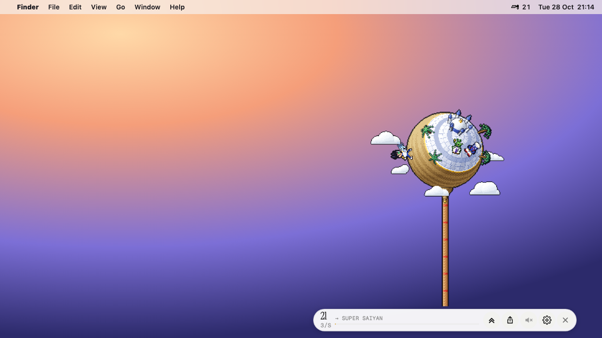

<div align="center">


# Idle FighterZ

**A tiny idle planet that lives on your desktop.**

Your hero runs laps around a pixel-art planet, powers up while you work, and fights off the occasional villain raid. Check in now and then, or play when you feel like it.

[](https://github.com/highskore/idle-fighterz-widget/releases/latest)


[](LICENSE)



</div>

## Features

- **Floats over your wallpaper.** A frameless, transparent widget, with no window chrome. Prefer a card? Switch to window mode.
- **Power level in the menu bar.** A pixel-art scouter with your number next to it, updated about once a second.
- **Plays itself.** Your hero keeps training while you work. Click to train harder, drag to spin the planet, hold to charge a beam.
- **Notifications that matter.** Villain raids, the dragon, trips and ascends can each notify you, with quiet hours, and never while you're looking at the widget.
- **Light on your machine.** The game runs natively, in Rust, and on macOS its frames go straight to the screen under the widget's HUD. It draws at 30 fps, and you can switch to battery saver. Hidden, it draws nothing and pauses, or ticks along at under 1% of one core if you want notifications or the menu-bar number.
- **Yours to tweak.** Size, HUD layout, clouds, opacity, always-on-top, launch at login and a global show/hide shortcut.

## Install

### macOS

```sh
brew install --cask highskore/tap/idle-fighterz
```

or

```sh
curl -fsSL https://highskore.com/install.sh | sh
```

> [!NOTE]
> Builds aren't notarized yet. The curl install opens right away. After a Homebrew or browser install, run `xattr -dr com.apple.quarantine "/Applications/Idle FighterZ.app"` once, or allow it in System Settings → Privacy & Security.

### Windows

```powershell
irm https://highskore.com/install.ps1 | iex
```

This installs for your user only, with no admin rights needed. You can also download the `-setup.exe` or `.msi` from the [latest release](https://github.com/highskore/idle-fighterz-widget/releases/latest).

> [!NOTE]
> Builds aren't code-signed yet, so a browser download triggers SmartScreen. Choose **More info → Run anyway**. The PowerShell install isn't affected.

### Linux

```sh
curl -fsSL https://highskore.com/install.sh | sh
```

This installs the AppImage to `~/.local/bin/idle-fighterz`, with a menu entry. On Debian and Ubuntu you can use the `.deb` from the [latest release](https://github.com/highskore/idle-fighterz-widget/releases/latest) instead.

<details>
<summary>Linux notes</summary>

- AppImages need FUSE 2: `sudo apt install libfuse2` (`libfuse2t64` on Ubuntu 24.04).
- **Floating needs a compositor.** Every Wayland desktop has one, as do GNOME, KDE and Xfce on X11. Without one, the widget stays in window mode.
- **The tray icon needs AppIndicator support.** KDE, Xfce, Cinnamon and Ubuntu have it built in. On stock GNOME, install the *AppIndicator and KStatusNotifierItem Support* extension. The power level shows as the tray menu's first item, and as a label beside the icon where the panel supports it (GNOME's extension does, KDE Plasma doesn't).
- **On Wayland there is no global shortcut**: it's an X11 key grab, so settings shows "not on wayland" in its place. Instead, bind a desktop shortcut to `idle-fighterz`: launching it again shows the running widget.

</details>

All installers verify downloads against the release's `SHA256SUMS`, and that file's minisign signature against a key they carry (see [docs/RELEASING.md](docs/RELEASING.md#signed-checksums)).

## Using it

| | macOS | Windows / Linux |
|---|---|---|
| Show or hide | <kbd>⌥</kbd><kbd>⌘</kbd><kbd>P</kbd> | <kbd>Ctrl</kbd><kbd>Alt</kbd><kbd>P</kbd> |
| Move the widget | Drag empty sky, or hold <kbd>⌥</kbd>/<kbd>⌘</kbd> and drag | Drag empty sky |
| Train | Click the planet | Click the planet |
| Settings | The gear, or the menu-bar icon | The gear, or the tray icon |

You can change the shortcut, or turn it off, in settings. If the menu-bar icon is hidden (a notch, a menu-bar manager), everything still works: open the app again and the widget comes back.

Progress isn't saved between launches, just like on [highskore.com](https://highskore.com). Your settings are kept.

## Build from source

You need Node and Rust, plus the [Tauri prerequisites](https://v2.tauri.app/start/prerequisites/) for your OS.

```sh
git clone --recurse-submodules https://github.com/highskore/idle-fighterz-widget.git && cd idle-fighterz-widget
npm ci
npm run build
```

The game itself lives in [highskore/idle-fighterz](https://github.com/highskore/idle-fighterz), as a submodule at `game/`. For how the widget page is built, every setting, platform details and the native renderer, see [docs/DEVELOPING.md](docs/DEVELOPING.md). Signing, notarizing and publishing releases are covered in [docs/RELEASING.md](docs/RELEASING.md).

## License

[MIT](LICENSE)
